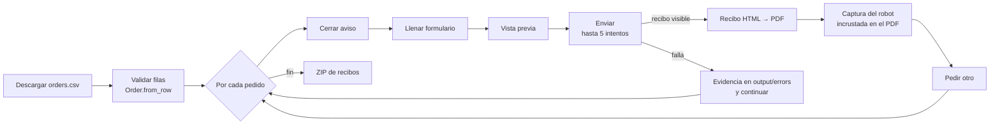

<div align="center">

# Robot de pedidos · Robocorp

**Bot RPA en Python que procesa pedidos en un aplicativo web: descarga el lote del día, llena el
formulario por cada fila, reintenta los envíos fallidos, genera un recibo PDF con la imagen del
producto y entrega todo en un ZIP.** Proyecto de la certificación *Robocorp Automation
Developer – Python (Level I)*.

[](https://github.com/DarwinMontiel/robocorp-order-robot/actions/workflows/ci.yml)


</div>

> **English summary** — Robocorp (now Sema4.ai) RPA bot that downloads a daily CSV of orders,
> fills a web form for each one through a Page Object, retries the site's intentionally flaky
> submit button, renders each receipt to PDF with the robot preview embedded, and zips all
> receipts. A failed order never stops the batch: evidence is captured and processing continues.

---

## Flujo



El sitio de práctica (*RobotSpareBin Industries*) rechaza aleatoriamente algunos envíos: el robot
lo trata como un **error de sistema** y reintenta hasta que aparece el recibo. Una fila con datos
inválidos es un **error de negocio** y se informa sin reintentar.

## Ejecutar

Con la extensión de Robocorp / Sema4.ai para VS Code: abrir la carpeta y ejecutar la tarea
`Run Task`. O con [RCC](https://github.com/robocorp/rcc) desde la terminal:

```bash
rcc run          # crea el entorno de conda.yaml y ejecuta tasks.py
```

Resultados en `output/`:

| Archivo | Contenido |
|---|---|
| `output/receipts/receipt_<n>.pdf` | Recibo de cada pedido con la imagen del robot |
| `output/receipts.zip` | Todos los recibos (entregable final) |
| `output/screenshots/` | Capturas de la vista previa de cada robot |
| `output/errors/` | Evidencia de pedidos que fallaron tras los reintentos |
| `output/log.html` | Log de ejecución de Robocorp |

## Estructura

```
tasks.py              # tarea @task: orquesta el lote y el manejo de fallas
robot/
├── config.py         # URLs, rutas de salida, selectores y política de reintentos
├── orders.py         # descarga del CSV y validación de filas (lógica pura)
├── order_page.py     # Page Object del formulario (toda la interacción con el navegador)
├── receipts.py       # PDF, imagen incrustada y ZIP (RPA Framework)
└── retry.py          # reintento genérico de pasos frágiles (lógica pura)
tests/                # pruebas de la lógica pura (sin navegador ni RPA Framework)
conda.yaml            # entorno reproducible (Python 3.12, rpaframework, robocorp)
robot.yaml            # definición de la tarea para RCC / Control Room
```

**Decisiones de diseño**

- **Page Object**: los selectores viven en un solo lugar (`config.Selectors`); si el sitio cambia,
  se corrige ahí y no en todo el flujo.
- **Lógica pura separada**: validar pedidos y reintentar no dependen del navegador, por eso se
  prueban en CI en milisegundos sin instalar RPA Framework.
- **Resiliencia por pedido**: un pedido que falla deja evidencia y el lote continúa; al final la
  tarea informa cuántos fallaron (así se puede reprocesar solo esos).
- **Logs sin datos sensibles**: los datos de cada pedido no se vuelcan al log
  (`log.suppress_variables`).

## Pruebas

```bash
pip install pytest ruff
pytest          # validación de filas, rutas de salida y política de reintentos
ruff check .
```

## Autor

**Darwin Montiel Mora** — Desarrollador RPA & Backend · Certificado *Robocorp Automation
Developer – Python* y *SS&C Blue Prism Developer*.
[LinkedIn](https://www.linkedin.com/in/darwin-montiel-mora-925216206) · [GitHub](https://github.com/DarwinMontiel)

Para una plataforma de bots en producción (colas RabbitMQ, reintentos, monitoreo de bots),
ver [rpa-orchestrator](https://github.com/DarwinMontiel/rpa-orchestrator).
