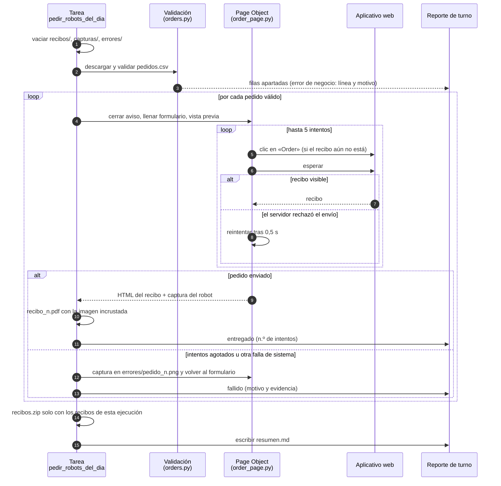

<div align="center">

# Robot de pedidos · Robocorp

**Bot RPA en Python que procesa el lote diario de pedidos de un aplicativo web: valida cada fila,
llena el formulario, reintenta los envíos que el servidor rechaza, genera un recibo PDF con la
imagen del producto, entrega los recibos en un ZIP y deja un reporte de turno.**
Proyecto de la certificación *Robocorp Automation Developer – Python* (niveles I a III).

[](https://github.com/DarwinMontiel/robot-pedidos-robocorp/actions/workflows/ci.yml)


</div>

---

## La historia

Son las 7:00 a. m. y llega el CSV del día con 20 pedidos. El aplicativo de *RobotSpareBin
Industries* (un sitio de práctica de Robocorp) rechaza al azar algunos envíos, y de vez en
cuando una fila viene incompleta. Un humano lo resolvería con paciencia y una hoja de cálculo
aparte; este robot hace lo mismo, pero con reglas explícitas:

- **Error de sistema** (el servidor rechaza el envío, una espera vence): se reintenta hasta 5
  veces; si no se logra, se guarda una captura como evidencia y **el lote sigue**.
- **Error de negocio** (una fila con columnas faltantes o un valor fuera de catálogo): no se
  reintenta, porque repetir no lo arregla. Se aparta con su número de línea y el motivo, sin
  copiar los datos de la fila, y **el lote sigue**.
- Al cierre, `output/resumen.md` dice qué se entregó, qué hay que reprocesar y qué hay que
  corregir en el origen. Si quedó algo pendiente, la tarea termina en error para que nadie
  lo pase por alto.

## Secuencia de un pedido



## Ejecutar

Con la extensión de Robocorp / Sema4.ai para VS Code: abrir la carpeta y ejecutar la tarea
**Pedir robots del día**. O con [RCC](https://github.com/robocorp/rcc) desde la terminal:

```bash
rcc run          # crea el entorno de conda.yaml y ejecuta la tarea
```

Cada ejecución vacía `recibos/`, `capturas/` y `errores/` antes de empezar, de modo que lo que
se entrega corresponde solo a ese día. Resultados en `output/`:

| Archivo | Contenido |
|---|---|
| `output/recibos/recibo_<n>.pdf` | Recibo de cada pedido con la imagen del robot |
| `output/recibos.zip` | Recibos entregados en esta ejecución (entregable final) |
| `output/resumen.md` | Reporte de turno: entregados, reintentos, fallidos y filas apartadas |
| `output/capturas/robot_<n>.png` | Vista previa de cada robot |
| `output/errores/pedido_<n>.png` | Evidencia de los pedidos que fallaron tras los reintentos |
| `output/pedidos.csv` | Lote del día tal como se descargó |
| `output/log.html` | Log de ejecución de Robocorp (sin los datos de los pedidos) |

Así se ve un reporte de turno con un pedido fallido y una fila apartada (datos ficticios, los
mismos que usan las pruebas):

```markdown
# Reporte de turno · Robot de pedidos

Inicio: 2026-01-05 07:00

| Indicador | Valor |
|---|---:|
| Filas en el CSV | 5 |
| Pedidos entregados | 3 |
| Reintentos usados | 2 |
| Fallidos (error de sistema) | 1 |
| Apartados (error de negocio) | 1 |

## Fallidos: reprocesar

| Pedido | Motivo | Evidencia |
|---:|---|---|
| 2 | enviar pedido: sin éxito tras 5 intentos | `output/errores/pedido_2.png` |

## Apartados: corregir en el origen

| Línea | Motivo |
|---:|---|
| 6 | falta la columna «Legs» |
```

## Estructura

```
tasks.py              # tarea @task: orquesta el lote y separa errores de sistema y de negocio
robot/
├── config.py         # URLs, entregables, selectores y política de reintentos
├── orders.py         # descarga del CSV y validación fila por fila (lógica pura)
├── order_page.py     # Page Object: toda la interacción con el navegador
├── receipts.py       # limpieza de la salida, PDF con imagen incrustada y ZIP
├── report.py         # reporte de turno en Markdown (lógica pura)
└── retry.py          # reintento genérico de pasos frágiles (lógica pura)
tests/                # pruebas sin navegador ni RPA Framework (página falsa de Playwright)
conda.yaml            # entorno reproducible (Python 3.12, rpaframework, robocorp)
robot.yaml            # definición de la tarea para RCC / Control Room
```

**Decisiones de diseño**

- **Page Object**: los selectores viven en un solo lugar (`config.Selectors`); si el sitio cambia,
  se corrige ahí y no en todo el flujo.
- **Espera explícita del recibo**: después de cada clic se espera a que el recibo aparezca
  (`locator.wait_for`), y antes de reintentar se verifica que no haya llegado tarde, para no
  enviar dos veces un pedido que ya pasó.
- **Validación fila por fila**: una fila mala no tumba el lote; se aparta con su línea y motivo.
- **Entregables honestos**: el ZIP se arma con la lista de recibos de esta ejecución, no con
  lo que haya en la carpeta.
- **Logs sin datos sensibles**: el log y el reporte nombran el pedido, la línea o la columna,
  nunca la dirección ni los valores de la fila (`log.suppress_variables` envuelve todo el lote,
  desde la lectura del CSV).
- **Recuperación que no tumba el lote**: si tras un pedido fallido tampoco se puede tomar la
  captura o recargar el formulario, el pedido queda registrado y se sigue con el siguiente.
- **Lógica pura separada**: validar, reintentar y reportar no dependen del navegador, por eso se
  prueban en CI en segundos sin instalar RPA Framework ni Chromium.

## Pruebas

```bash
pip install -r requirements-dev.txt
ruff check . && ruff format --check .
mypy            # tipado estricto
pytest          # validación, Page Object con página falsa, recibos, ZIP y reporte
```

## Qué demuestra y cómo se relaciona con mi experiencia

Este repositorio es el proyecto práctico del Nivel I de la certificación *Robocorp Automation
Developer – Python*, que completé hasta el Nivel III. Lo reescribí con los criterios que uso en
bots que corren todos los días en una fintech de cartera y cobranzas:

| En este robot | En un bot de cobranza (ejemplo ficticio) |
|---|---|
| Pedido del CSV del día | Acuerdo de pago que hay que registrar en el portal de un acreedor |
| Recibo PDF con la imagen del robot | Soporte del acuerdo que se adjunta al expediente del deudor |
| Error de sistema: el servidor rechaza el envío | El portal responde lento o se cae: reintentar con límite |
| Error de negocio: fila incompleta o fuera de catálogo | Obligación inexistente o datos incompletos: devolver al área, no reintentar |
| Reporte de turno | Informe al coordinador: qué quedó registrado y qué hay que reprocesar |

La misma separación entre excepción de sistema y excepción de negocio es la que aplico en Blue
Prism (también certificado) y la base de la plataforma de bots
[colmena-rpa](https://github.com/DarwinMontiel/colmena-rpa) (colas RabbitMQ, reintentos y
monitoreo), cuyas colas vigila [torre-de-control](https://github.com/DarwinMontiel/torre-de-control)
en tiempo real. Para automatización con lectura de documentos, ver
[vigia-ocr](https://github.com/DarwinMontiel/vigia-ocr).

## Licencia y atribución

Apache 2.0 (ver [LICENSE](LICENSE)). El proyecto parte de la plantilla oficial de Robocorp para
Python, publicada bajo la misma licencia; los cambios propios se describen en [NOTICE](NOTICE)
y [CHANGELOG.md](CHANGELOG.md).

## Autor

**Darwin Montiel Mora** — Desarrollador RPA & Backend en Bogotá · Certificado *Robocorp
Automation Developer – Python* (niveles I a III) y *SS&C Blue Prism Developer*.
[LinkedIn](https://www.linkedin.com/in/darwin-montiel-mora-925216206) · [GitHub](https://github.com/DarwinMontiel)
